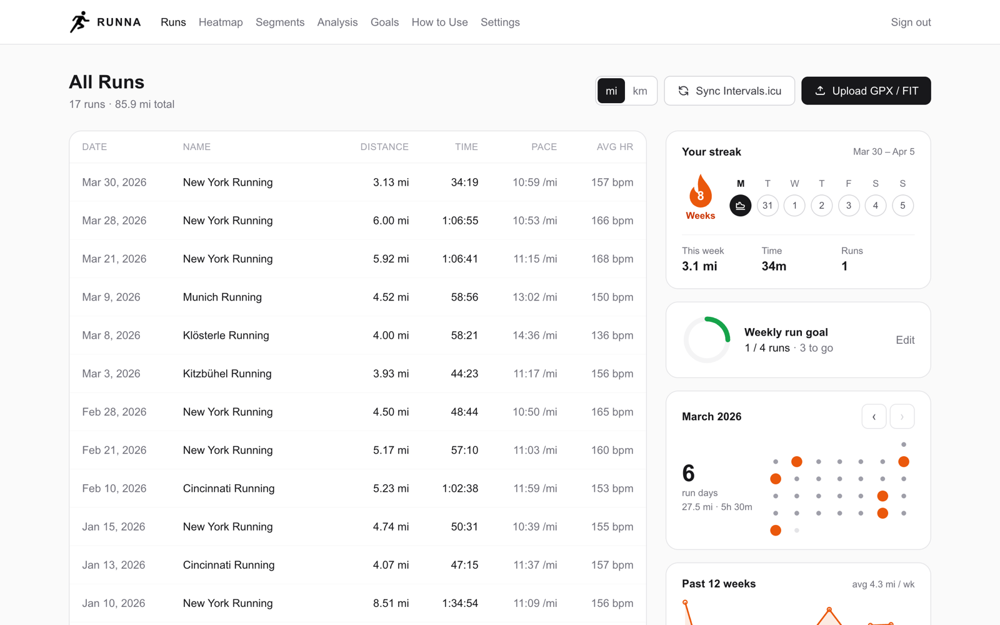
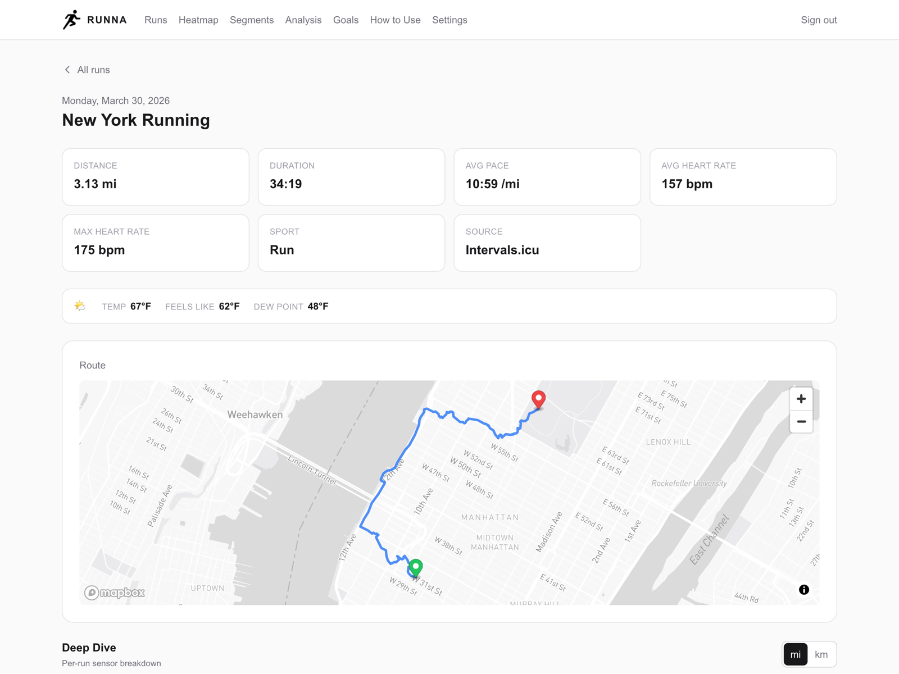
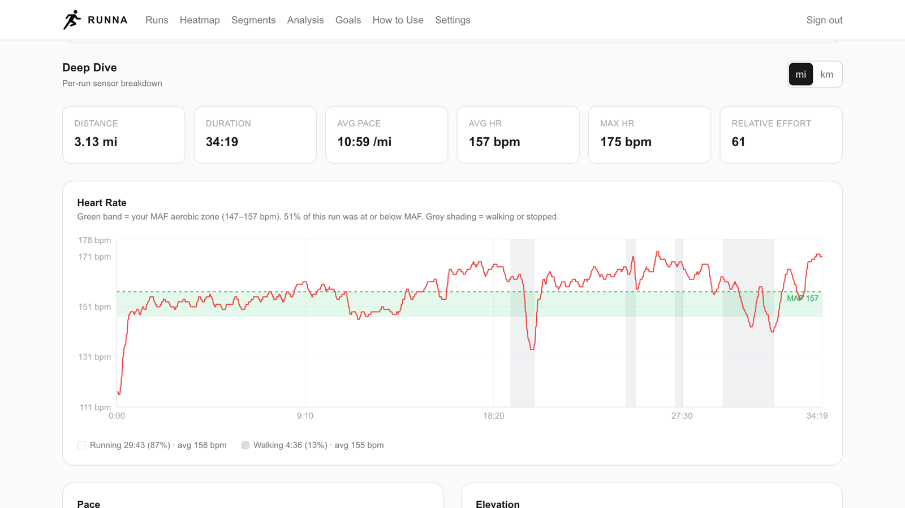
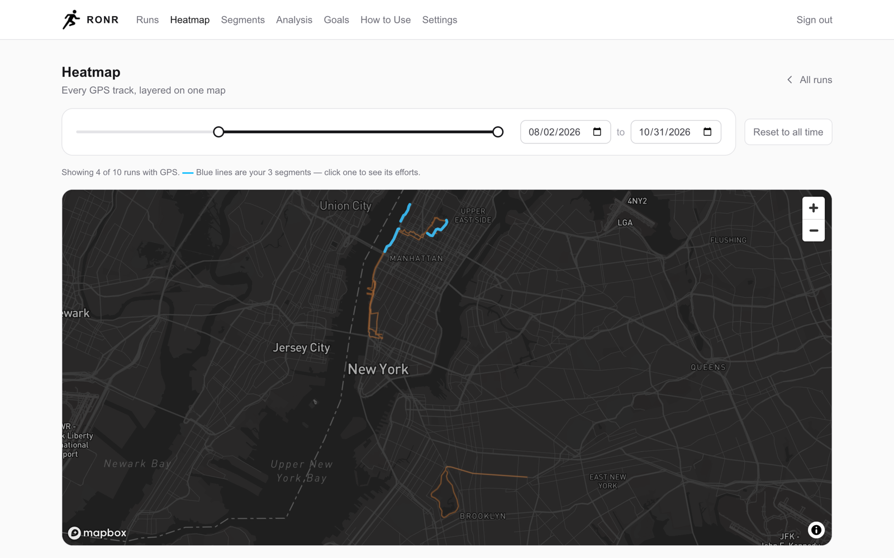
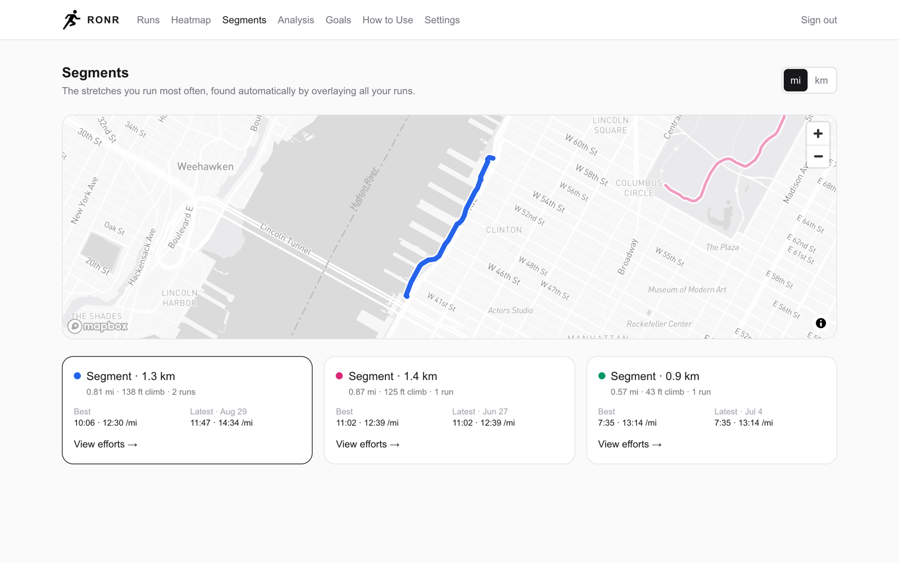
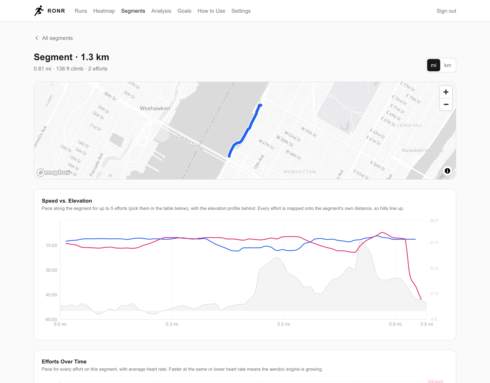
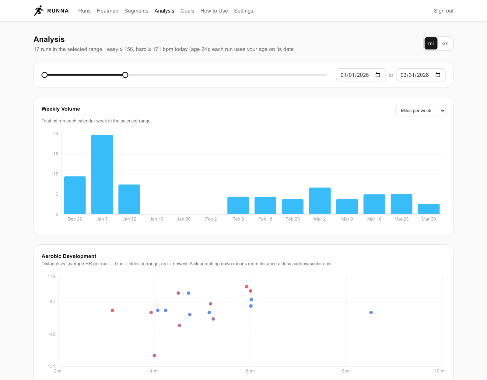
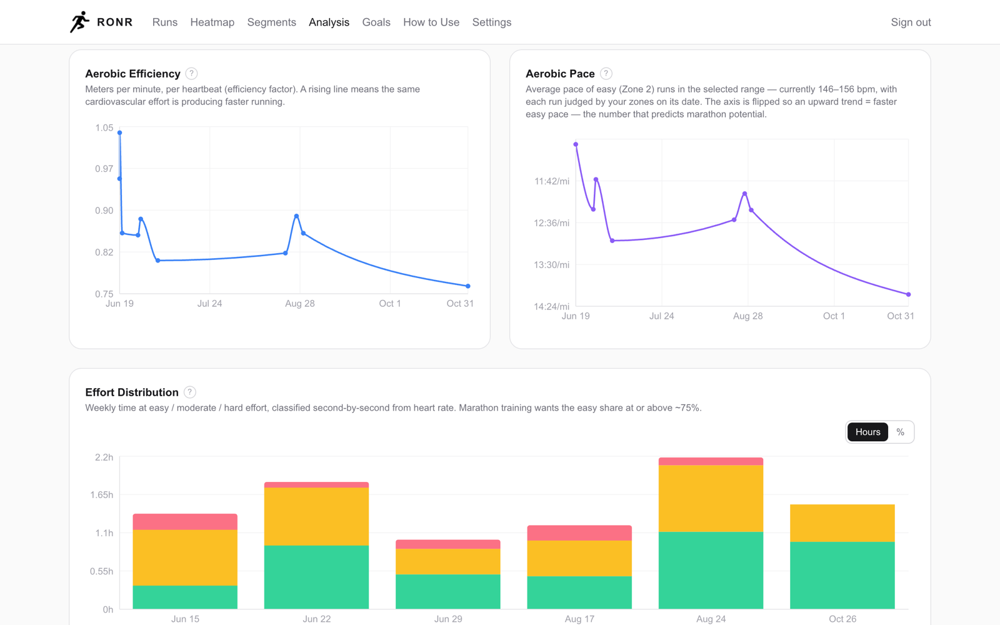
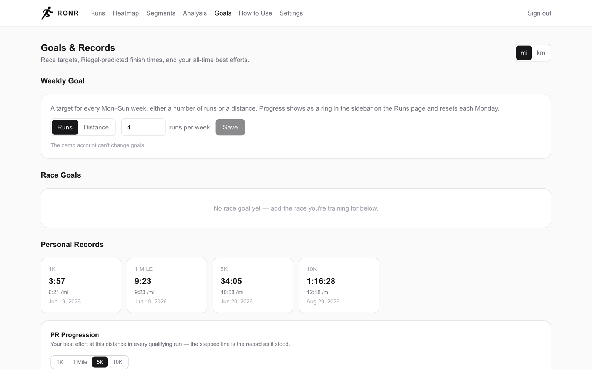

# RONR — Personal Running Dashboard

*The name: RONR is short for Ron Ranjan, and it's "runner" without the vowels.*

A private running dashboard for one runner. It pulls your runs from Intervals.icu (which syncs from Garmin and Strava) or from GPX/FIT files you upload, then turns them into maps, trends and coaching-style analysis built around one idea: **build a strong aerobic base, consistently, without getting hurt.**

*Screenshots show the demo account's sample data.*

**Contents:** [Features](#features) · [Getting started](#getting-started) · [Getting your data in](#getting-your-data-in) · [Weekly routine](#a-simple-weekly-routine) · [Project structure](#project-structure) · [Tech stack](#tech-stack)

> New to the app? The **How it works** page (`/guide`, no sign-in needed) explains every page and chart, and what to do about it.

---

## Features

### Runs

Your full log: date, distance, time, pace, heart rate and source. Switch between miles and kilometers at any time (the choice is remembered).

Next to the list, the **activity sidebar** shows whether the habit is holding: your weekly streak, progress on your weekly goal, a month calendar of run days, and distance for the past 12 weeks.



### Run detail

Click a run to see its route on a map (green start, red finish), the weather at run time, and a **Deep Dive**: heart rate, pace, cadence and elevation through the run, plus per-mile splits and any segments you passed through.





### Heatmap

Every GPS track layered on one dark map. Routes you run often glow brighter. It opens on the **last 90 days around your most recent run**, wherever that was. Drag the date slider to change the range, or click **Reset to all time** to see every run. Your segments appear as blue lines you can click.



### Segments

The stretches you run most often, found automatically by spotting where many runs share the same path. Each segment times every pass you've made, so you can see whether you're getting faster at the same heart rate, and compare up to five efforts side by side.





### Analysis

Trends across many runs. A date slider at the top drives most charts; the training-load charts always use your full history.

| Chart | The question it answers |
|---|---|
| **Training Plan** | What should my next 7 days look like, based on my recent load? |
| **Weekly Volume** | Is my mileage consistent and growing gradually? |
| **Aerobic Development** | Is the same distance costing my heart less over time? |
| **Aerobic Efficiency** | How much speed does each heartbeat buy me? |
| **Aerobic Pace** | Is my easy (Zone 2) pace getting faster? |
| **Effort Distribution** | Are ~75% of my minutes actually easy? |
| **Running Form** | How are my cadence and step length trending? |
| **Run/Walk Split** | How much of each run is running vs. walking breaks? |
| **Performance vs. Weather** | How much do heat and humidity slow *me* down? |
| **Fitness & Fatigue** | Where are my fitness, fatigue and form (CTL / ATL / TSB)? |
| **Acute : Chronic Load** | Am I ramping up faster than my body can absorb? |
| **Long Run Progression** | Is my longest run of the week building steadily? |





### Goals

Set a weekly goal (runs or distance) and race goals. For each race, the app predicts your finish time from recent best efforts. It also tracks personal records from 1K to the marathon, detected from your runs automatically.



### Settings

Your birthday (used to set heart-rate zones), the time zone used for days and weeks, and your login history.

### Demo account

Anyone can explore the app at `/demo` (or **See the app without logging in** on the login page), no password needed. The demo is read-only and shows a sample of the 10 latest runs in New York City.

---

## Getting started

### 1. Prerequisites

- Node.js 20+
- A PostgreSQL database (local or hosted, e.g. Neon or Supabase)
- A free [Mapbox](https://account.mapbox.com/access-tokens/) access token for the maps
- *(Optional)* An [Intervals.icu](https://intervals.icu) account, for automatic sync

### 2. Install

```bash
git clone https://github.com/RonRan123/running-app.git
cd running-app
npm install
```

### 3. Create `.env.local`

Create a `.env.local` file in the project root with these values:

| Variable | What it's for |
|---|---|
| `DATABASE_URL` | Your PostgreSQL connection string |
| `NEXTAUTH_URL` | The app's URL, e.g. `http://localhost:3000` |
| `NEXTAUTH_SECRET` | Any long random string (`openssl rand -base64 32`) |
| `ADMIN_EMAIL` | The email you sign in with |
| `ADMIN_PASSWORD_HASH` | A bcrypt hash of your password (see below) |
| `NEXT_PUBLIC_MAPBOX_TOKEN` | Your Mapbox token |
| `INTERVALS_API_KEY` | *(Optional)* From Intervals.icu → Settings → API Access |
| `INTERVALS_ATHLETE_ID` | *(Optional)* From the same page |
To hash a password:

```bash
node -e "console.log(require('bcryptjs').hashSync('your-password', 10))"
```

> **Escape the `$` signs.** Next.js expands `$` in env files, which breaks bcrypt hashes. Write each `$` in the hash as `\$`.

### 4. Set up the database

```bash
npx prisma migrate deploy
```

### 5. Run it

```bash
npm run dev
```

Open [http://localhost:3000](http://localhost:3000) and sign in with your `ADMIN_EMAIL` and password.

---

## Getting your data in

You never log runs by hand. Use either option, or both:

- **Sync from Intervals.icu:** with the Intervals.icu variables set, click **Sync Intervals.icu** on the Runs page to pull in new activities. Connect Garmin or Strava inside Intervals.icu and your runs flow through.
- **Upload files:** click **Upload GPX / FIT** on the Runs page and pick `.gpx` or `.fit` files exported from your watch.

---

## A simple weekly routine

- **After each run:** open its Deep Dive. Was the effort what you intended?
- **Once a week:** open Analysis. Check Effort Distribution (enough easy?), Acute : Chronic Load (ramping safely?) and Weekly Volume (consistent?).
- **Once a month:** widen the date range and look at Aerobic Efficiency and Aerobic Pace. Is the engine growing?

---

## Project structure

```
app/
  (protected)/      Signed-in pages: runs, analysis, segments, goals, settings
  guide/            Public "How it works" page
  demo/             One-click entry into the read-only demo
  api/              Route handlers: activities, sync, segments, goals, settings, auth
  login/            Sign-in page
components/         UI, grouped by page (analysis/, deepdive/, goals/, segments/, settings/)
lib/                Data access, analysis math, sync, file parsers, weather, training plan
prisma/             Database schema and migrations
```

## Scripts

| Command | What it does |
|---|---|
| `npm run dev` | Start the dev server on port 3000 |
| `npm run build` | Generate the Prisma client and build for production |
| `npm start` | Run the production build |
| `npm test` | Run the unit tests (Vitest) |

## Tech stack

| Layer | Choice |
|---|---|
| Framework | Next.js 16 (App Router), React 19 |
| Database | PostgreSQL + Prisma |
| Auth | NextAuth.js (credential login: one admin, one optional demo user) |
| Maps | Mapbox GL JS |
| Charts | Recharts |
| Weather | Open-Meteo historical API |
| Styling | Tailwind CSS 4 |
| Tests | Vitest |
| Deployment | Vercel |
